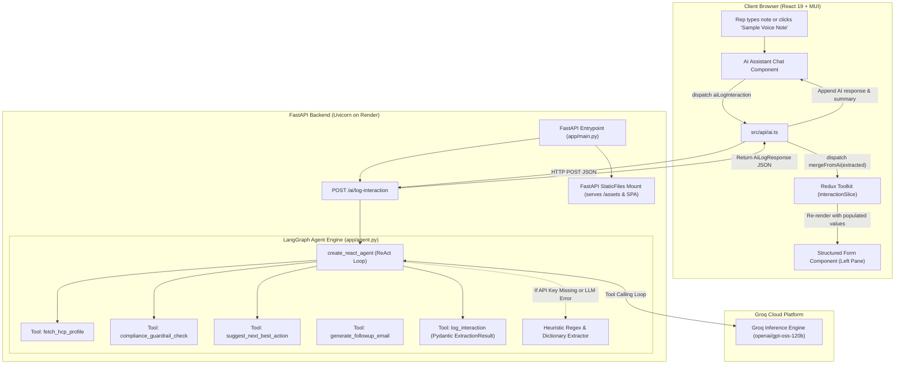

# Comprehensive Project Documentation: AI-First CRM (HCP Module)

**Live Production Application:** [https://ai-first-crm-hcp-iptt.onrender.com/](https://ai-first-crm-hcp-iptt.onrender.com/)  
**GitHub Repository:** [https://github.com/AARUSH-SING/AI-First_CRM_HCP-Module](https://github.com/AARUSH-SING/AI-First_CRM_HCP-Module)  
**Core Technologies:** React 19 • TypeScript • Material-UI (MUI v9) • Redux Toolkit • FastAPI • LangGraph • Groq LPU (openai/gpt-oss-120b) • Docker

---

## Table of Contents
1. [Executive Summary & Purpose](#1-executive-summary--purpose)
2. [What the Project Does](#2-what-the-project-does)
3. [System Architecture & Data Flow](#3-system-architecture--data-flow)
4. [How It Works: Step-by-Step Execution Journey](#4-how-it-works-step-by-step-execution-journey)
5. [Complete File-by-File Breakdown](#5-complete-file-by-file-breakdown)
   - [Root Configuration & Deployment Files](#51-root-configuration--deployment-files)
   - [Backend Application (`backend/`)](#52-backend-application-backend)
   - [Frontend Application (`frontend/`)](#53-frontend-application-frontend)
6. [Deep Dive: The AI LangGraph Agent Engine](#6-deep-dive-the-ai-langgraph-agent-engine)
7. [Deep Dive: Frontend State Management & UI](#7-deep-dive-frontend-state-management--ui)
8. [DevOps, Containerization & Production Deployment](#8-devops-containerization--production-deployment)
9. [User Guide & Example Testing Scenarios](#9-user-guide--example-testing-scenarios)

---

## 1. Executive Summary & Purpose

In the pharmaceutical, biotechnology, and medical device industries, field sales representatives and Medical Science Liaisons (MSLs) frequently conduct meetings with **Healthcare Professionals (HCPs)**—such as physicians, clinic directors, hospital department heads, and key opinion leaders (KOLs).

### The Real-World Problem
Every discussion between a field rep and an HCP is strictly regulated by regulatory authorities (such as the US FDA, EMA in Europe, and CDSCO in India), compliance statutes (such as the Sunshine Act / Open Payments), and industry codes (such as PhRMA and EFPIA codes).
Field reps must record:
- Exactly who attended the discussion.
- What clinical topics, studies, and indications were discussed.
- Whether any promotional materials, clinical reprints, or dosing guides were provided.
- Whether physical product samples were distributed (strictly tracked lot numbers and quantities).
- The HCP's reaction and sentiment toward the clinical efficacy/safety data.
- Agreed action items and next-best actions.

In legacy CRM systems (such as Veeva CRM, Salesforce Life Sciences Cloud, or IQVIA OCE), reps must navigate rigid, multi-page web forms with 20+ dropdowns, text areas, and checkboxes after every doctor visit. Reps frequently postpone logging until the weekend, leading to forgotten details, inaccurate data, and compliance risks.

### The AI-First Solution
The **AI-First CRM (HCP Module)** solves this friction by providing a **dual-entry, human-in-the-loop paradigm**:
1. **Conversational Entry (Right Pane):** Reps can casually dictate, type, or paste raw notes or audio transcripts (e.g. *"Met Dr. Sarah Smith yesterday at City Hospital to review clinical data on our oncology trial. She was very positive about the efficacy metrics and requested the full study brochure."*).
2. **Autonomous Entity & Patch Extraction:** A **LangGraph** ReAct agent parses the unstructured text, consults mock MDM databases, verifies compliance guardrails, infers sentiment, and compiles structured field values.
3. **Structured Verification (Left Pane):** The extracted data automatically populates the standard structured CRM form in real-time. The human rep remains in the loop to review, edit, or adjust any field before finalizing the log.

---

## 2. What the Project Does

The application provides a single-screen, split-view interface tailored for field reps logging an HCP engagement:

1. **Natural Language Note Parsing:** Converts conversational English into standardized CRM entities.
2. **Entity Normalization:** Automatically standardizes physician names (`Dr. Sarah Smith`), interaction types (`Meeting`, `Call`, `Virtual`, `Email`), and dates.
3. **Sentiment Analysis:** Categorizes doctor reception into standardized states: `Positive`, `Neutral`, or `Negative`.
4. **Materials & Samples Tracking:** Matches mentioned literature against known brand assets (e.g., `Product Brochure`, `Dosing Guide`, `Clinical Reprint`) and populates sample tags.
5. **AI Summarization & Compliance Review:** Generates a concise executive interaction summary and drafts compliant follow-up tasks without promotional bias.
6. **Heuristic Fallback Engine:** Operates reliably even if the Groq LLM API is unavailable, utilizing local pattern matching to extract fields.
7. **Single Unified Cloud Web Service:** Packages both the React frontend and FastAPI backend into a single container hosted on Render.

---

## 3. System Architecture & Data Flow



---

## 4. How It Works: Step-by-Step Execution Journey

1. **User Action:** The rep navigates to `https://ai-first-crm-hcp-iptt.onrender.com/`. The client loads the pre-compiled React single-page application.
2. **Input Entry:** The rep inputs unstructured text into the chat logger on the right pane:
   > *"Met with Dr. Sarah Smith yesterday at City Hospital to review clinical data on our oncology trial. She was very positive about the efficacy metrics and requested the full study brochure and slide deck."*
3. **Frontend API Call:** 
   - `App.tsx` calls `aiLogInteraction({ message, currentForm })` defined in `src/api/ai.ts`.
   - The payload transmits both the raw text note and the current snapshot of the form.
4. **Backend Processing:**
   - FastAPI receives the request at `/ai/log-interaction` and validates the body via `AiLogRequest` Pydantic model.
   - `run_log_interaction_via_langgraph` is invoked.
5. **Agent Inference & Tool Calling:**
   - The agent evaluates system instructions: life-sciences compliance rules, entity extraction guidelines, and standard field constraints.
   - It invokes Groq (`openai/gpt-oss-120b`) to call the `log_interaction` tool.
   - The tool executes `with_structured_output(ExtractionResult)` to enforce strong schema typing.
6. **Response Formulation:**
   - The backend constructs an `AiLogResponse`:
     - `extracted`: A JSON patch containing only inferred fields (`hcpName`, `topicsDiscussed`, `materialsShared`, `sentiment`, `outcomes`, `followUpActions`).
     - `summary`: A concise 1-sentence interaction summary.
     - `suggestedFollowUps`: A list of 2–3 compliant next-best actions.
7. **Form Update (Left Pane):**
   - The frontend receives the JSON response.
   - Redux dispatches `mergeFromAi(extracted)`.
   - The form fields instantly populate with smooth UI transitions without overwriting unaffected fields.
   - The chat thread updates with the AI summary and action checklist.

---

## 5. Complete File-by-File Breakdown

### 5.1 Root Configuration & Deployment Files

#### 1. `.env`
- **Location:** Project root (`.env`)
- **Purpose:** Stores local environment configuration and sensitive credentials.
- **Key Variables:**
  - `GROQ_API_KEY`: Secret API key for Groq Cloud.
  - `GROQ_MODEL`: Specifies the active model identifier (configured to `openai/gpt-oss-120b`).
- **Security:** Excluded from git commits via `.gitignore`.

#### 2. `.env.example`
- **Location:** Project root (`.env.example`)
- **Purpose:** Public template demonstrating required environment variables for developers and automated CI/CD runners without exposing secrets.

#### 3. `.gitignore`
- **Location:** Project root (`.gitignore`)
- **Purpose:** Prevents accidental leakage of secrets, compiled bundles, and environment files to GitHub.
- **Ignored Patterns:** `.env`, `.env*.local`, `node_modules/`, `frontend/dist/`, `backend/.venv/`, `__pycache__/`, `*.pyc`, `.DS_Store`, `Thumbs.db`.

#### 4. `Dockerfile`
- **Location:** Project root (`Dockerfile`)
- **Purpose:** Production multi-stage Docker build that generates a unified container image hosting both frontend and backend.
- **Stage 1 (`frontend-builder`):** Uses `node:22-alpine` to install dependencies and compile the React application via `npm run build` into `frontend/dist`.
- **Stage 2 (`runner`):** Uses `python:3.12-slim` to install Python dependencies from `backend/requirements.txt`, copies backend application code, copies compiled static assets from Stage 1 into `frontend/dist`, and starts `uvicorn backend.app.main:app` listening on `$PORT`.

#### 5. `docker-compose.yml`
- **Location:** Project root (`docker-compose.yml`)
- **Purpose:** Orchestrates container builds locally or on a VPS. Maps port `8000:8000`, forwards `GROQ_API_KEY` and `GROQ_MODEL`, and configures automated restart policies.

#### 6. `render.yaml`
- **Location:** Project root (`render.yaml`)
- **Purpose:** Infrastructure-as-Code (IaC) blueprint for Render.com.
- **Specifications:** Defines a single web service of type `docker` on the free tier, pointing to `Dockerfile`, configuring port routing, and declaring the `GROQ_API_KEY` environment secret requirement.

#### 7. `README.md`
- **Location:** Project root (`README.md`)
- **Purpose:** Project introduction, features overview, quickstart instructions for local development (PowerShell / Bash), model compatibility notes (Groq deprecations and replacements), and architecture summary.

#### 8. `DEPLOYMENT.md`
- **Location:** Project root (`DEPLOYMENT.md`)
- **Purpose:** Step-by-step production deployment documentation covering Render Blueprint deployment, Railway container hosting, Vercel + Render split setups, and Docker self-hosting.

---

### 5.2 Backend Application (`backend/`)

#### 9. `backend/requirements.txt`
- **Location:** `backend/requirements.txt`
- **Purpose:** Lists all Python packages required by the backend:
  - `fastapi`: High-performance asynchronous web API framework.
  - `uvicorn[standard]`: ASGI production server.
  - `pydantic` & `pydantic-settings`: Data validation, type safety, and schema serialization.
  - `python-dotenv`: Automated loading of environment variables from `.env` files.
  - `langgraph`: Multi-actor agent workflow orchestration.
  - `langchain` & `langchain-core`: Foundation abstractions, prompt templates, and tools.
  - `langchain-groq`: Groq LPU inference integration.
  - `sqlalchemy`, `psycopg2-binary`, `pymysql`: Database connectors for enterprise CRM expansion.

#### 10. `backend/app/__init__.py`
- **Location:** `backend/app/__init__.py`
- **Purpose:** Designates `backend/app` as a Python package, enabling module imports like `backend.app.main`.

#### 11. `backend/app/main.py`
- **Location:** `backend/app/main.py`
- **Purpose:** The core FastAPI application server.
- **Key Responsibilities:**
  - Loads `.env` from repo root and backend directory.
  - Configures CORS middleware allowing cross-origin requests from local dev ports (`5173`, `3000`) and production origins.
  - Implements `GET /health` returning `{"status": "ok"}` for container health probes.
  - Implements `POST /ai/log-interaction`: Accepts `AiLogRequest`, runs the LangGraph extraction pipeline, drops `None` values, and returns `AiLogResponse`.
  - **Unified Static Hosting:** Detects if `frontend/dist` exists. If present, it mounts `StaticFiles(directory="frontend/dist/assets")` under `/assets` and handles Single-Page Application (SPA) catch-all routing (`serve_frontend_spa`), serving `index.html` for any client-side routes.

#### 12. `backend/app/schemas.py`
- **Location:** `backend/app/schemas.py`
- **Purpose:** Defines the data contracts and Pydantic validation schemas.
- **Models:**
  - `Sentiment`: Literal type constrained to `"positive" | "neutral" | "negative"`.
  - `InteractionType`: Literal type constrained to `"Meeting" | "Call" | "Email" | "Virtual"`.
  - `InteractionForm`: Represents the full state of the CRM form (HCP name, date, time, attendees, topics, materials, samples, sentiment, outcomes, follow-ups).
  - `AiLogRequest`: Validates incoming payload containing `message: str` and `currentForm: InteractionForm`.
  - `ExtractedInteraction`: Optional subset/patch model of `InteractionForm` allowing partial extractions without forcing unmentioned fields.
  - `ExtractionResult`: The structured output model returned by the LLM containing `extracted`, `summary`, and `suggestedFollowUps`.
  - `AiLogResponse`: Outgoing response contract returning the extracted patch dictionary, summary, and follow-ups.

#### 13. `backend/app/agent.py`
- **Location:** `backend/app/agent.py`
- **Purpose:** The cognitive core of the backend. Contains the LangGraph agent, tool definitions, Groq client initializations, and fallback extraction algorithms.
- **Key Components:**
  - `_base_llm_for_model(model)`: Initializes `ChatGroq` with temperature 0.2 and LRU caching.
  - `_structured_llm()`: Binds `ExtractionResult` using `with_structured_output` for deterministic JSON formatting.
  - `fetch_hcp_profile`: Tool that simulates looking up physician specialty, affiliated hospital, and communication preferences.
  - `compliance_guardrail_check`: Tool that flags potential off-label promotion or adverse event cues.
  - `suggest_next_best_action`: Tool that generates 3 context-aware follow-up tasks.
  - `generate_followup_email`: Tool that drafts non-promotional follow-up correspondence under 140 words.
  - `log_interaction`: Core tool that performs the structured extraction from free-text notes into `ExtractionResult`.
  - `edit_interaction`: Tool that modifies existing interaction data based on corrective user instructions.
  - `build_langgraph_agent()`: Compiles the tools and LLM into a ReAct agent using `create_react_agent`.
  - `heuristic_extract_interaction`: Resilient offline regex/dictionary parser that extracts HCP names, channels, materials, samples, and sentiment if Groq API keys are absent or network errors occur.
  - `run_log_interaction_via_langgraph`: Main orchestrator that dispatches the user note to the agent and safely captures tool outputs.

---

### 5.3 Frontend Application (`frontend/`)

#### 14. `frontend/package.json`
- **Location:** `frontend/package.json`
- **Purpose:** Node.js project manifest.
- **Key Dependencies:**
  - `react` & `react-dom` (v19.2.5): Core UI library.
  - `@mui/material` & `@mui/icons-material` (v9.0.0): Enterprise UI components and icon set.
  - `@emotion/react` & `@emotion/styled`: CSS-in-JS styling engine powering MUI.
  - `@reduxjs/toolkit` (v2.11.2) & `react-redux`: Modern global state management.
  - `@fontsource/inter`: Self-hosted Google Inter font for consistent typography across operating systems.
  - `typescript` & `vite`: TypeScript compiler and lightning-fast build tool.

#### 15. `frontend/tsconfig.json`
- **Location:** `frontend/tsconfig.json`
- **Purpose:** TypeScript compiler configuration enforcing strict typing, ES module resolution, JSX React runtime, and DOM library definitions.

#### 16. `frontend/vite.config.ts`
- **Location:** `frontend/vite.config.ts`
- **Purpose:** Configures Vite bundler with `@vitejs/plugin-react` and locks local development server port to `5173`.

#### 17. `frontend/index.html`
- **Location:** `frontend/index.html`
- **Purpose:** HTML5 entrypoint for the Single-Page Application. Sets page title (`AI-First CRM – Log HCP Interaction`), loads favicon, and mounts the `#root` DOM element.

#### 18. `frontend/.gitignore`
- **Location:** `frontend/.gitignore`
- **Purpose:** Ignores `node_modules`, `dist/`, and local environment variables within the frontend directory.

#### 19. `frontend/public/favicon.svg` & `frontend/public/icons.svg`
- **Location:** `frontend/public/`
- **Purpose:** Vector brand assets and icon sprites for medical CRM styling.

#### 20. `frontend/src/assets/hero.png`, `typescript.svg`, `vite.svg`
- **Location:** `frontend/src/assets/`
- **Purpose:** Static image assets including branding illustrations and framework badges.

#### 21. `frontend/src/styles/global.css`
- **Location:** `frontend/src/styles/global.css`
- **Purpose:** Global CSS resets. Configures body font family to `Inter, sans-serif`, sets background color palette (`#f8fafc`), and removes default margin/padding.

#### 22. `frontend/src/store/store.ts`
- **Location:** `frontend/src/store/store.ts`
- **Purpose:** Configures the Redux Toolkit store, mounting `interactionSlice` under the `interaction` state slice. Exports `RootState` and `AppDispatch` types.

#### 23. `frontend/src/store/hooks.ts`
- **Location:** `frontend/src/store/hooks.ts`
- **Purpose:** Exports pre-typed Redux hooks: `useAppDispatch = useDispatch.withTypes<AppDispatch>()` and `useAppSelector = useSelector.withTypes<RootState>()`.

#### 24. `frontend/src/store/interactionSlice.ts`
- **Location:** `frontend/src/store/interactionSlice.ts`
- **Purpose:** Central Redux state slice governing the CRM interaction form.
- **State Structure (`InteractionFormState`):**
  - `hcpName`: string
  - `interactionType`: `'Meeting' | 'Call' | 'Email' | 'Virtual'`
  - `date`: string (defaults to today's ISO date `YYYY-MM-DD`)
  - `time`: string (defaults to current `HH:MM`)
  - `attendees`: string
  - `topicsDiscussed`: string
  - `materialsShared`: string[]
  - `samplesDistributed`: string[]
  - `sentiment`: `'positive' | 'neutral' | 'negative'`
  - `outcomes`: string
  - `followUpActions`: string
  - `aiSuggestedFollowUps`: string[]
- **Reducers:**
  - `setField`: Updates a single key/value pair.
  - `mergeFromAi`: Applies a partial update dictionary to state without modifying non-included fields.
  - `addMaterial` / `removeMaterial`: Manages multi-select shared literature tags.
  - `addSample` / `removeSample`: Manages multi-select drug sample tags.
  - `resetForm`: Restores initial state.

#### 25. `frontend/src/api/ai.ts`
- **Location:** `frontend/src/api/ai.ts`
- **Purpose:** Frontend network client for the AI backend.
- **Smart Base URL Resolution:**
  ```typescript
  const API_BASE_URL = (import.meta as any).env?.VITE_API_BASE_URL ?? (import.meta.env.PROD ? '' : 'http://localhost:8000')
  ```
  - In local development: Points to `http://localhost:8000`.
  - In production: Uses relative empty string `''`, allowing all API calls to seamlessly target the same domain serving the UI (e.g. `https://ai-first-crm-hcp-iptt.onrender.com/ai/log-interaction`).
- **Function `aiLogInteraction`:** Performs HTTP POST with JSON headers, serializes request, and handles error deserialization.

#### 26. `frontend/src/main.tsx`
- **Location:** `frontend/src/main.tsx`
- **Purpose:** React application bootstrap. Imports Inter font weights (`400`, `500`, `600`, `700`), wraps the tree with Redux `<Provider store={store}>`, and mounts `<App />` into `#root`.

#### 27. `frontend/src/App.tsx`
- **Location:** `frontend/src/App.tsx`
- **Purpose:** The primary view component containing the dual-pane user interface:
  - **Top Navigation Bar:** Title, compliance indicator chip, and quick reset action.
  - **Left Column (Structured Form):**
    - Physician search field with autocomplete icon.
    - Interaction channel selector (Meeting, Call, Virtual, Email).
    - Date and time pickers.
    - Multi-select chips for Materials Shared (`Product Brochure`, `Dosing Guide`, `Clinical Reprint`).
    - Multi-select chips for Samples Distributed (`10mg Starter Pack`, `25mg Sample Box`).
    - Sentiment radio group with color-coded sentiment icons.
    - Discussion topics and outcomes text areas.
    - AI Suggested Follow-Ups checklist with click-to-adopt action.
    - Save Interaction button.
  - **Right Column (AI Chat Logger):**
    - Conversational chat message stream.
    - "Sample Voice Note Transcription (Try Demo)" quick-fill trigger button.
    - Chat note input field with submit button and loading spinner.
    - Summary and status alert banners.

---

## 6. Deep Dive: The AI LangGraph Agent Engine

The backend relies on **LangGraph**, LangChain's library for building stateful, multi-actor LLM applications.

### 1. The ReAct Pattern Loop
Rather than using a single static prompt, LangGraph constructs a **Reasoning + Acting (ReAct)** loop:
```
User Prompt + Current Form JSON
       ↓
LLM Thought: "The rep mentioned Dr. Sarah Smith and oncology study results. I should call log_interaction."
       ↓
Action: log_interaction(note="...", current_form_json="...")
       ↓
Observation: Returns structured ExtractionResult JSON
       ↓
LLM Final Answer: "Extracted interaction details for Dr. Sarah Smith."
```

### 2. Structured Outputs with Pydantic
In `backend/app/agent.py`, the agent uses LangChain's `.with_structured_output(ExtractionResult)`:
```python
def _structured_llm():
    return _base_llm().with_structured_output(ExtractionResult)
```
This forces the Groq LLM to respond exclusively in valid JSON adhering to the Pydantic schema, guaranteeing that fields like `sentiment` strictly map to `"positive" | "neutral" | "negative"` and `materialsShared` is always an array of strings.

### 3. Heuristic Fallback Engine
To prevent system failure when offline or if an API key expires, `heuristic_extract_interaction()` acts as an automated safety net:
- **Doctor Name Regex:** `\b(?:Dr\.|Doctor|Dr)\s+([A-Z][a-zA-Z]+)` extracts formal names.
- **Interaction Channels:** Scans for keywords (`met` -> Meeting, `call` -> Call, `teams`/`zoom` -> Virtual, `email` -> Email).
- **Sentiment Keyword Classifier:** Maps tokens like *receptive, positive, enthusiastic, great* -> `positive`; *hesitant, skeptical, unhappy* -> `negative`.
- **Material Matching:** Matches known pharmaceutical documents against lowercase token occurrences.

---

## 7. Deep Dive: Frontend State Management & UI

### Non-Destructive Patch Merging
A key challenge in AI-assisted forms is preventing the AI from overwriting fields the user already manually edited.

The Redux reducer solves this via `mergeFromAi`:
```typescript
mergeFromAi(state: InteractionFormState, action: PayloadAction<Partial<InteractionFormState>>) {
  return { ...state, ...action.payload }
}
```
Because the backend only includes fields in the patch that were explicitly detected in the note (`_drop_nones(extraction.extracted.model_dump())`), any existing fields that were untouched by the AI conversation remain preserved.

### Material-UI Design System
The UI adheres to the life-sciences aesthetic:
- **Typography:** Google Inter (`@fontsource/inter`), standard for medical data density.
- **Palette:** Clinical slate blues (`#0f172a`, `#2563eb`), neutral light gray backgrounds (`#f8fafc`), and distinct semantic colors (success green for positive sentiment, error red for negative).

---

## 8. DevOps, Containerization & Production Deployment

### Multi-Stage Container Architecture
The project utilizes a two-stage `Dockerfile`:
```
[Stage 1: Node 22 Alpine]
  ├── Copies frontend/package.json
  ├── Installs dependencies (npm install)
  ├── Compiles TypeScript & Vite (npm run build)
  └── Produces static artifacts in /app/frontend/dist/

[Stage 2: Python 3.12 Slim]
  ├── Installs backend requirements (pip install -r requirements.txt)
  ├── Copies backend application files
  ├── Copies /app/frontend/dist from Stage 1 into /app/frontend/dist
  └── Runs uvicorn backend.app.main:app on 0.0.0.0:$PORT
```

### Advantages of the Unified Deployment:
1. **Zero CORS Issues:** The browser interacts with the API on the exact same domain that served the HTML.
2. **Single Free Instance:** Render's free tier allows 1 active web service. Stacking frontend and backend together eliminates the need for separate hosting accounts.
3. **Automated Continuous Deployment:** Pushing any commit to the `main` branch of GitHub automatically triggers a Docker build and redeployment on Render.

---

## 9. User Guide & Example Testing Scenarios

Open the live URL: **[https://ai-first-crm-hcp-iptt.onrender.com/](https://ai-first-crm-hcp-iptt.onrender.com/)**

### Scenario A: Oncology Trial Update
Paste this note into the right-hand chat box and click **Log Interaction**:
> *"Met with Dr. Sarah Smith yesterday at City Hospital to review clinical data on our oncology trial. She was very positive about the efficacy metrics and requested the full study brochure and slide deck."*

**Expected Result:**
- **HCP Name:** `Dr. Sarah Smith`
- **Channel:** `Meeting`
- **Topics:** `oncology data`
- **Materials:** `Product Brochure`, `Slide Deck`
- **Sentiment:** `Positive` (Green indicator)
- **Outcomes:** `Study brochure requested`
- **Follow-up Actions:** `Send the requested study brochure to Dr. Sarah Smith`

### Scenario B: Virtual Dosing Inquiry
Paste this note:
> *"Had a virtual Zoom call with Dr. Robert Chen regarding pediatric dosing guidelines. He was hesitant regarding the dosing interval and requested a clinical study reprint."*

**Expected Result:**
- **HCP Name:** `Dr. Robert Chen`
- **Channel:** `Virtual`
- **Materials:** `Dosing Guide`, `Clinical Study Reprint`
- **Sentiment:** `Negative` / Hesitant (Orange/Red indicator)

### Scenario C: One-Click Voice Note Demo
Click the **"Sample Voice Note Transcription (Try Demo)"** button above the chat box. It populates a pre-transcribed doctor note into the input box ready for instant extraction.
